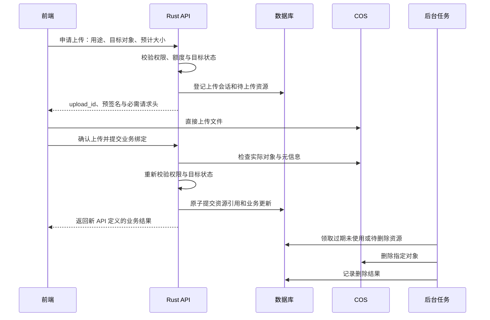

# Rust 后端：全新项目架构与资源生命周期设计

本目录用于存放全新 Rust 后端代码。本文件记录业务范围、腾讯云 COS 直传、持久化后台任务和资源回收设计；原项目仅作为业务与风险参考。

> 状态：Rust 后端、前端适配及 Docker Compose 部署已实现，并通过本地端到端烟测。部署步骤见 [DEPLOYMENT.md](DEPLOYMENT.md)。腾讯云 COS 和模型服务使用独立协议夹具验证，未提供真实云凭证；实桶 CORS/IAM、模型质量与生产备份恢复仍需在实际部署环境验证。

## 1. 目标与结论

目标：

- 使用 Rust 构建全新后端，参考原项目的业务能力，但不承担旧客户端或旧数据兼容。
- 支持预签名上传，客户端直接上传至 COS，不经业务 API 服务器中转。
- 定时回收上传后未被使用的资源。
- 定时回收已删除业务对象关联、且不再需要保留的资源。

项目从空数据库和独立资源空间开始，按**新业务契约 + COS 直传 + 持久化后台任务 + 资源生命周期管理**设计，不再以原后端一比一兼容为目标。

已选择 Rust 作为新后端技术栈。COS 直传和资源回收本身不依赖 Rust；性能收益需在实现后测量，不能作为已验证结论。

已确定采用**模块化单体 Rust API + MongoDB 持久化任务 + Rust 后台执行器（worker）+ COS**。MongoDB 同时保存业务数据和任务状态；新后端移除 RabbitMQ、Celery，不引入 Redis。初期 API 与后台执行器在同一进程运行，以简化部署；worker 是执行角色，不是必须单独部署的服务。只有实测出现后台任务影响 API 或需要独立扩容时，才考虑分进程，不必拆分代码项目或微服务。

不实现旧 API 兼容层、旧上传中转入口、旧数据导入或旧存储对象迁移。新项目产生的历史修订版、被替换资源和备份仍属于生命周期管理范围，不应与原项目的旧数据混淆。

## 2. 全新项目边界

### 2.1 不承担旧系统兼容

- 不支持旧客户端，无需沿用旧 API 路径、请求参数、响应结构、错误码或上传协议。
- 不迁移旧用户、密码哈希、登录令牌、业务记录、文件、头像、导出或下载链接。
- 不沿用 MongoEngine 短字段名、旧索引与引用结构；新 MongoDB schema 按业务和查询需求设计。
- 不迁移 OSS 对象，不保留 OSS/CDN 鉴权实现，不设计新旧系统双写、切换或迁移回滚。
- 原项目只作为功能清单与风险参考，其同名覆盖、修订版和完结删除行为不是默认的新产品契约。

### 2.2 新项目需要定义的契约

- 前端与后端共同采用新 API；明确请求、响应、错误、分页、空值、日期和国际化规范。
- 上传统一采用“申请上传 → 直传 COS → 确认并绑定”，不提供客户端文件经 API 中转的兼容入口。
- 新账户认证独立设计密码存储、会话或令牌、过期及撤销机制，不受 Werkzeug 或 `itsdangerous` 格式约束。
- 明确团队与项目角色继承、权限允许与拒绝行为。
- 明确同名判断、图片替换、文本修订版、文件夹移动及删除政策。
- 明确 OCR、解析、导入导出的任务状态、结果格式和失败恢复行为。
- 新资源统一登记、鉴权与回收；API 和内部资源大小均使用字节。

新后端不采用 Celery 消息协议。邮件、解析、导入导出等后台能力使用 MongoDB 持久化任务和 Rust 后台执行器。外部 OCR/模型服务可保留 Python 实现，但新项目接入不能依赖 Celery。

## 3. 原项目参考与资源风险

以下为原项目的静态代码观察，只用于发现业务场景和设计风险，不构成兼容或迁移要求；推断项不代表已完成运行复现。

| 当前行为 | 对新设计的影响 |
| --- | --- |
| 每次上传生成新的 `ObjectId + 后缀`，计算 MD5 后上传，并非按 MD5 去重；见 `models/file.py:668-680` | 不建议同时引入内容去重，避免新增共享资源删除语义 |
| 同名图片替换原文件，文本保留历史修订版；见 `models/project.py:613-669` | 非激活修订版不等于无用资源 |
| 替换时先删除旧源文件，再上传新文件；见 `models/file.py:659-680` | 应先验证新资源，再切换引用，最后延迟回收旧资源 |
| `Project.files()` 默认仅返回激活版，`Project.clear()` 使用它删除物理对象后级联删除文档；见 `models/project.py:750-786,938-943` | 静态推断存在非激活修订版对象遗留、引用文档却被删除的路径 |
| 导出物理删除失败只记录日志，项目删除仍可能继续；见 `models/output.py:58-86` | 删除意图必须持久化，不能只尝试一次 COS 删除 |
| 用户头像、团队头像、文件、导出使用不同存储前缀；见 `config.py:84-89` | 回收范围不能仅限于 `File.save_name` |
| 本地模式生成缩略图，OSS 模式依赖图片处理参数；见 `tasks/thumbnail.py:37-66`、`services/oss.py:243-245` | 新项目需分别选择派生对象或 COS 图片处理方案，无需继承 OSS 参数 |
| 项目销毁计划可以取消；见 `models/project.py:859-885` | 待销毁不等于立即允许物理删除 |
| 项目完结删除部分物理资源但保留文档；见 `models/project.py:821-857` | 完结、待销毁、已删除和可恢复需要不同保留政策 |

以上表格中的路径均相对于 `../backend-v1/app/`。

必须明确：业务对象仍然存在，不一定意味着源文件必须存在；当前页面不显示，也不意味着资源可删除。

## 4. 推荐上传流程

### 4.1 数据职责

至少在逻辑上分离三个概念，不要求拆成独立服务：

| 概念 | 主要职责与信息 |
| --- | --- |
| 上传会话 | 申请者、用途、目标对象、授权截止时间、预计大小、完成情况 |
| 物理资源 | bucket、key、必要时的 version ID、实际大小、校验结果、生命周期状态 |
| 业务引用 | 哪个文件修订版、头像或导出结果正在使用资源 |

前端提交 `upload_id` 或资源 ID。不能允许前端任意提交 COS key 或 URL，并直接绑定为自己的资源。

内部资源大小与新 API 均统一使用字节，不保留旧 API 的 KB 单位转换。

资源引用模型要覆盖新项目产生的历史修订版和任务占用。不为未提出的内容去重功能引入复杂引用计数；但删除判定仍需确保不存在有效引用。

### 4.2 授权与确认

- 使用短有效期签名，只授权精确 key 和精确操作，不授予整桶写权限。
- key 由服务端生成，原始业务文件名作为元数据保存。
- 申请上传与确认绑定时都检查权限、项目状态和目标对象是否存在。
- 不只相信前端声明的大小、类型和哈希。`HEAD` 可验证对象存在与部分元信息，不能证明内容安全。
- 确认操作必须幂等，重复提交不能重复创建修订版、扣额度或触发解析。
- COS 直传绕过 Flask 请求体大小限制，需要重新设计单文件限制、待上传额度预占、并发额度和滥用防护。
- 绑定及业务更新需要原子提交。使用 MongoDB 事务时，先核对部署是否具备事务支持条件；否则必须设计可恢复的提交状态。

### 4.3 保证已绑定内容不可变

预签名 URL 不是一次性上传券。不能出现“资源已验证并绑定，客户端仍使用有效授权覆盖同一个对象”的情况。

已选择**暂存区直传 → 验证 → COS 内部复制到正式唯一 key → 业务绑定**。客户端只能写暂存资源，没有正式 key 写权限；替换时更新资源引用，不覆盖正式对象。

复制必须固定已验证的源内容，例如指定源版本或使用适用的条件复制，并验证复制结果，防止检查和复制之间暂存对象被覆盖。具体能力需通过 COS 实桶验证，不允许在验证不足时直接绑定可变对象。

复制不经业务 API 服务器转发文件，但增加暂存资源和失败恢复管理。复制成功、业务绑定失败的正式对象仍需登记为未绑定资源并回收。

## 5. 定时回收设计

主路径由数据库资源登记和业务引用驱动。桶清单对账用于发现历史或异常孤儿对象，不应直接作为删除依据。

### 5.1 上传后未使用的资源

- 创建上传会话时登记对象 key，即使客户端后来没有上传也能追踪。
- 区分未上传、上传失败、已上传未确认、已确认未绑定等情况，并设置明确到期时间。
- 超过保留期后进入回收候选。
- 回收窗口考虑签名有效期、已开始但未结束的上传和分块上传。
- 防止资源被删除后，又被迟到上传或迟到分块完成重新创建；需要上传会话收束、分块中止或后续对账兜底。

### 5.2 曾使用但业务不再需要的资源

- 用户删除业务对象时撤销正常访问并进入回收站，保留资源引用或可恢复的引用记录；恢复期结束后解除引用并持久化回收意图。替换资源时，验证新资源、原子切换引用后，再登记旧资源回收。
- 业务变更与回收意图在同一事务提交，或使用可恢复的持久化状态。
- 宽限期结束后由后台任务执行物理删除。
- 存在其他有效引用、历史保留要求或任务占用时，不允许删除。
- 默认系统资源不属于普通用户回收范围。

### 5.3 必须成立的不变量

1. **绑定与回收互斥。** GC 原子领取资源进入 `deleting` 后，业务不能再绑定它。只在删除前查询一次引用不能消除竞态。
2. **数据库与 COS 无跨系统事务。** 必须处理 COS 已删除、数据库更新失败等中间状态。
3. **删除幂等、可重试、可恢复。** 对象不存在可视为完成；403、超时和网络错误不能当作成功。
4. **批量删除逐项检查结果。** 整次请求成功不等于全部对象删除成功。
5. **成功前不丢失定位信息。** 不提前 TTL 删除待回收资源记录，避免漏删后失去 key 和版本信息。
6. **任务执行有占用保护。** OCR、缩略图和导出期间保护输入资源；占用需要到期与恢复机制，防止 worker 崩溃后永久阻止回收。
7. **迟到任务不能复活业务资源。** 业务删除后，任务结果不能重新绑定；任务生成的孤儿产物也要登记并回收。
8. **多实例可安全执行。** 后台领取需要原子条件更新或租约，进程崩溃后能够重新领取。

删除记录应包含对象定位信息、删除原因、状态、尝试次数、下次重试时间和错误信息。回收过程要能追踪候选数量、成功数量、失败积压和最长等待时间。

### 5.4 COS 生命周期与桶对账

COS 生命周期适合兜底处理暂存对象、未完成分块和历史版本，不能判断业务引用是否有效。

- 暂存区自动过期必须与正式资源隔离，不能误删已绑定对象。
- 开启版本控制时，明确删除当前可见对象还是应清理的全部版本。
- 删除标记不等于历史版本已经释放存储。
- 桶对账使用登记表、保留规则、宽限期和候选复核。新项目使用独立 bucket 或明确隔离的前缀，只处理自身资源，不扫描或删除原项目及其他应用的对象。

## 6. 必须覆盖的资源类别

- 用户头像、团队头像和被替换的旧头像。
- 项目原文件、文本历史修订版。
- ZIP 和 LabelPlus 导入包。
- 缩略图、内容审核用派生图。
- 导出的 ZIP、文本和失败任务产物。
- OCR 使用的临时资源。
- worker 本地临时文件。
- 默认头像等系统公共资源，单独设置保留策略。

原项目 ZIP 导入一次提交 `project` 与 `labelplus` 两个文件，见 `../frontend-v1/src/apis/project.ts:148-159`。新项目应为导入包分别登记上传资源，再由业务操作引用；不复用原 multipart 接口。

直传的边界应定义为：**客户端上传字节不经过 API 服务器；业务处理需要的文件读取允许由后台任务执行。** 图片解码、文本解析、ZIP 导入、OCR 和导出仍可能需要从 COS 读取内容。

## 7. 安全、访问与任务架构

### 7.1 内容与下载安全

- 私有资源下载也需要鉴权，不能仅保护上传。
- 数据库删除或权限撤销不保证已经签发的下载 URL 与 CDN 缓存立即失效，需定义允许的失效窗口。
- 上传内容使用隔离的资源域名，控制 `Content-Type`、下载响应头与公开访问范围。
- ZIP 解压限制路径、解压体积和文件数量；图片限制像素规模，不只是压缩后的文件大小。
- 内容校验或审核未通过前，不允许作为正式可访问资源绑定。
- 前端授权属于短期访问凭证，不应在日志中记录完整预签名 URL 或密钥。

### 7.2 浏览器上传体验

需实际验证 CORS、必需签名请求头、上传进度、取消、重试、续传和过期重签。

普通 PUT、表单上传和分块上传的能力与限制不同。尤其文件大小约束、校验和、覆盖保护不能假设仅凭预签名自动具备，选定方式后需逐项实测。

### 7.3 COS 存储设计

新项目直接使用 COS，不实施 OSS 到 COS 的对象或引用迁移。需要定义并验证：

- 对象上传、读取、删除和下载签名。
- 图片处理与封面访问。
- 内容审核和 OCR 获取资源的方式。
- 资源域名、可选 CDN 鉴权、缓存与失效行为。
- 独立资源空间、对象 key 规则和资源登记，避免触及其他项目的数据。

ETag 不应未经验证就作为所有上传方式的内容 MD5 使用。

### 7.4 已确定的任务架构

RabbitMQ 和 Celery 在新后端中由 MongoDB 持久化任务及 Rust worker 替代。Redis 不作为当前必需组件；只有测量证明任务领取轮询或执行延迟存在问题时，才重新评估专用队列。

#### 部署与职责

- 单进程部署：一个 Rust 服务同时启动 HTTP API 和后台任务领取循环，共用工程和业务模块；不要求单独启动 worker 进程。
- HTTP API 模块：处理请求、权限与业务提交，持久化登记任务；HTTP handler 不等待耗时任务完成，也不只靠 `tokio::spawn` 或内存队列保证后台工作。
- 后台执行器模块：从 MongoDB 原子领取并执行邮件、解析、导入导出等任务；持久化、租约、重试和幂等机制不因同进程部署而省略。
- 资源回收：直接领取资源记录中的到期回收工作，复用租约与重试原则，不复制一套等价的资源删除任务状态。
- 定时器仅唤醒扫描，到期时间与工作状态保存到 MongoDB；重启后继续处理到期工作，多实例不依赖单机定时器保证正确性。

#### 同进程执行与资源边界

- COS、邮件和外部模型等网络调用使用异步 I/O，并设置超时。
- ZIP 压缩、图片解码和同步库调用不得直接占用 Tokio 异步执行线程；使用 `spawn_blocking` 或专用线程池，并在提交工作前限制并发，避免无界排队。
- 轻重任务设置独立并发配额，明确每实例及全局上限；增加 API 实例不能无意间无限增加后台并发。
- 限制单任务文件规模、解压体积、图片像素和内存占用。线程池只隔离阻塞执行，不提供进程级故障或内存隔离；后台任务导致进程崩溃或 OOM 时，API 同样受影响。
- `spawn_blocking` 中已经开始的工作不能靠取消异步句柄强行终止。长计算需协作检查取消状态，并用领取身份及业务版本条件控制结果提交。
- API 与后台执行器随服务一起重启；退出时停止领取，在限定时间内收束在途任务，未完成工作由租约恢复，不提前释放仍在产生副作用的任务租约。
- 后台执行器保持独立模块边界。后续只有测量显示 API 延迟、资源争用或扩容需求需要时，才增加独立 worker 启动模式；MongoDB 任务协议与业务代码无需因此重写。

#### 任务记录

建议字段如下，实际 schema 在实现时固定：

| 字段 | 职责 |
| --- | --- |
| `kind`、`payload`、`payload_version` | 任务类型、必要参数与参数协议版本；不存文件正文或长期访问凭证 |
| `status` | `queued`、`running`、`succeeded`、`failed`、`cancelled` |
| `run_at` | 最早可执行时间，兼用于延迟和失败重试 |
| `attempts`、`max_attempts` | 执行次数与上限 |
| `lease_until`、`claim_token` | 当前领取租约及本次执行身份 |
| `dedup_key` | 需要去重的业务操作标识，配合适用范围的唯一索引 |
| `progress`、`result_ref`、`last_error` | 进度、结果引用与可诊断错误 |
| `created_at`、`finished_at` | 创建与终结时间 |

终态记录按保留政策清理。不得 TTL 删除仍在排队、执行或等待重试的任务；删除记录和业务结果引用需分别考虑保留期。

#### 领取、续租与恢复

1. 使用带条件的原子 `findOneAndUpdate` 领取到期任务，设置 `running`、租约和新的 `claim_token`；领取时计入尝试次数。
2. 长任务定期续租，完成、续租、失败更新都校验任务状态与本次 `claim_token`。失去领取权后停止后续业务写入。
3. 租约过期的任务可恢复或重新领取，超过执行次数上限进入终态失败，不无限接管。
4. 暂时性失败按有上限的退避和抖动设置下一次 `run_at`；不可重试错误直接记录失败。
5. 对到期领取、过期租约恢复查询建立适合实际过滤和排序的索引，分页限批扫描；不能无索引全表轮询。
6. 优雅退出时停止领取，允许在途任务在限定时间内完成或由租约机制恢复；不能仅凭进程退出把外部操作判定为失败。

任务采用**至少一次执行**语义，不承诺通用 exactly-once。`claim_token` 能防止旧 worker 覆盖新的任务状态，但不能阻止已经发出的 COS、邮件或模型请求，因此业务副作用仍需幂等或补偿：COS 删除可重复执行；导出重试不能重复创建业务记录；OCR 结果不能重复插入；邮件可能重复发送的边界需单独定义。

#### 业务一致性与资源保护

- 业务变更与任务登记优先在同一 MongoDB 事务提交，实施前确认副本集或分片部署等事务前提。
- 不具备事务条件时，通过持久化业务待处理状态和补偿扫描恢复缺失任务；不能将连续两次写入视为原子操作。
- 文件修订版、导出记录等业务 ID 作为幂等依据；任务重试重新检查对象状态及预期版本，拒绝将迟到结果绑定到已删除或已替换对象。
- 任务运行期间登记并续租输入资源占用；失去租约后不能继续提交业务结果。已经生成的未绑定输出仍需登记并回收。
- 容量限制、超时、取消与并发配额由任务类型定义；重型图片或 ZIP 工作不应阻塞 API 或轻任务。

#### 外部 OCR/模型服务接入

原项目 `../backend-v1/app/tasks/mit.py:18-35` 定义 Celery 任务名，实际实现位于外部仓库 `manga_translator/moeflow_worker.py`。此信息仅用于辨认模型实现与任务执行框架的边界，不要求复用旧 worker。

原项目实际存在三条识别相关路径：传统 Google Vision OCR、可选外部 MIT worker，以及前端直连多模态模型的 AI 翻译。传统 OCR 在 `tasks/ocr.py:419-421` 无条件抛出 `NotImplementedError`，单图解析在 `models/file.py:883-884` 提前返回；不能将其描述为当前可用能力。前端 `services/ai/llm_preprocess.ts` 直接调用模型提取文本、位置与翻译，再通过业务 API 保存结果，不使用后端 OCR 队列。

新项目已使用后端持久化调度：Rust 执行器管理权限、任务状态和结果保存，外部模型仅负责计算。当前接入 OpenAI 兼容的多模态 `/chat/completions` 同步接口，前端通过本地任务 ID 查询状态、取消及取得已保存结果。成功响应持久化后，恢复重试复用该响应；若进程在供应商接受请求后、响应持久化前崩溃，供应商不支持幂等/操作查询时仍可能重复计算或计费，不能承诺外部模型 exactly-once。模型凭证仅配置在后端，未接入原 Celery/MIT 协议。

## 8. 已确定的初始资源政策

以下政策已按用户选择作为新项目初始设计。时间参数可配置；调整配置时不应隐式缩短已经承诺的恢复窗口。政策已确定不代表功能已实现或经过实桶验证。

### 8.1 初始期限与部署选择

| 项目 | 初始政策 | 计时或行为边界 |
| --- | --- | --- |
| 项目完结 | 只读，不自动删除源文件和历史修订版 | 项目存在期间保留并计入容量；恢复编辑不依赖找回已删除对象 |
| 业务删除恢复期 | 7 天 | 从逻辑删除时间计算；到期开始永久回收，不承诺该时刻所有物理对象已删除 |
| 普通上传签名 | 15 分钟 | 过期后仅能在有效上传会话内重新申请 |
| 上传会话 | 最长 24 小时 | 从会话创建时间计算，分块续传不无限延长会话 |
| 已上传未绑定资源 | 24 小时 | 从服务端确认完成时间计算；未确认的对象由会话到期扫描检查并回收 |
| 用户导出文件 | 7 天 | 从成功生成时间计算；到期显示已过期，源数据仍在时允许重新生成 |
| 临时资源 | 任务结束立即清理，24 小时兜底 | 从登记生成时间计算；有效任务占用期间延后清理，释放占用后过期资源可立即回收 |
| 私有下载签名 | 5 分钟 | 权限变化立即阻止新签名；既有签名存在有效期与已开始下载的访问窗口 |
| CDN | 初期不启用 | 出现访问性能需求后单独评估鉴权与缓存失效 |
| 正式内容不可变 | 暂存验证后复制到正式唯一 key | 客户端无正式 key 写权限，固定已验证源内容后复制 |
| COS 版本控制 | 不作为默认前提 | 如备份或源内容固定方案需要，再启用并定义历史版本清理 |
| 容量与执行并发 | 可配置，部署前经测试固定数值 | 无文件规模和机器规格依据，不在设计文档中编造限额 |
| 备份 | 数据库与对象保护配套 | 支持的恢复窗口及 RPO/RTO 在部署前核定，并演练验证 |

### 8.2 完结、删除与恢复

- 不增加另一套待销毁倒计时，初期使用回收站统一表达删除后的恢复窗口。
- 删除后立即停止业务访问和新任务，现有任务取消或收束；删除不能靠任务永久占用而无限推迟。
- 状态依次为正常、逻辑删除可恢复、永久删除处理中、永久删除完成。进入永久删除处理中后拒绝恢复。
- 恢复与 GC 原子互斥；可恢复阶段保留数据库记录、源资源和必要引用信息，不能先解除所有保护再等待 7 天。
- 原始资源、保留修订版及回收站资源计入容量，完结不释放容量。导出适用独立期限，完结不阻止下载尚未过期的导出或重新导出。
- 被替换的资源只在无有效业务引用、无保留要求、无任务占用且满足物理删除保护期限时回收。

### 8.3 上传和临时资源收束

- 会话到期拒绝继续签发授权，并中止未完成分块；已有签名和在途请求不能假定立即撤销，需迟到上传对账兜底。
- 前端未确认完成的上传不能无限保留；后台在会话到期时核对实际对象，登记回收。
- 未绑定资源到期或已进入回收后，绑定返回明确错误，不复活会话或资源。
- 暂存对象完成安全复制后登记删除；复制和绑定失败的产物不得遗漏。
- 导出到期后不再签发下载链接，保留必要生成参数和过期状态。临时对象与本地任务目录都需要崩溃恢复清理。

### 8.4 OCR / 模型调用与资源访问

- Rust 负责持久化调度和业务结果写入，外部服务只负责计算；不要求模型本身用 Rust 实现。
- 长任务使用操作 ID、状态查询与结果查询；去重及重复计费风险按所选服务真实能力处理。
- 模型仅访问已授权资源，使用受限服务身份或短期签名下载，不接受任意用户 URL，不公开 bucket。
- 模型输入有可续租任务占用，输出资源登记；对象删除或替换后迟到结果不能重新绑定。
- 供应商或自部署模型尚未选定，具体凭证、端点和支持的协议需在实现前核对；不将设计接口当成现有供应商能力。

### 8.5 容量与内容限制

- 项目文件归团队容量，用户头像归用户容量；资源不单纯按上传者归属。
- 申请时预占，验证后按实际字节结算；失败或过期释放预占，回收站继续占容量，物理删除成功后释放存储额度。
- 历史修订版、未绑定上传和导出占用需要明确统计；同一物理对象不因多个引用重复统计，暂存与复制开销单独监控。
- 限制单文件字节、图片宽高及总像素、ZIP 解压总大小、条目数与路径、OCR 页数、导出输入规模及用户/团队任务并发。
- 前端声明不能作为内容验证或计费依据；无法存储侧强制的约束由后置验证及申请限流兜底。

### 8.6 私有访问与备份恢复

- 使用私有 bucket，下载前实时检查权限，数据库保存资源定位信息，不保存永久可访问 URL。
- 短期签名不保证严格即时撤销，也无法收回客户端已下载的内容；若以后要求即时撤销，需另行设计逐请求鉴权入口。
- 数据库备份必须匹配资源备份、受控历史版本或覆盖恢复窗口的延迟物理删除方案，不能仅凭数据库备份宣称完整恢复。
- 用户恢复期与运维灾难恢复窗口分别管理；物理删除必须满足选定的备份保护边界。未建立并验证保护方案前，不开启生产环境不可逆 GC。
- 恢复时先停 GC 和任务领取，对账资源、任务状态和外部操作后再继续；不能未经核对重放邮件、模型请求或旧删除任务。
- 定期演练数据库及对象联合恢复，明确已物理删除且无备份对象不可恢复。这是新项目自身的恢复要求，不是旧数据迁移。

## 9. 实施顺序

1. 定义新业务契约、认证方案、MongoDB schema、资源清单和保留政策。
2. 建立完整垂直链路：申请、直传、验证、绑定、替换、删除、定时回收。
3. 验证任务原子领取、租约、幂等、竞态与故障恢复，再扩展到全部业务与上传入口；接入选定的外部 OCR/模型服务。
4. 在空数据库和独立 COS 资源空间中验证端到端行为，不实施原项目旧数据或资源迁移。
5. 验证同进程部署的资源限制、并发配额、优雅退出和任务重启恢复。
6. 验证新项目自身的备份恢复边界；物理删除不能仅通过恢复数据库撤销。
7. 回收先运行只读预演并核对候选清单，再开启物理删除。

## 10. 验收清单

### 10.1 新业务与数据契约

- [ ] 全新账户注册、登录、密码验证和会话或令牌过期、撤销符合新认证契约。
- [ ] API 成功和错误结果、分页、空值、日期和权限行为符合新契约。
- [ ] 空数据库初始化、新 schema、索引、引用和缓存计数正确，不要求读取原项目旧数据。
- [ ] 同名图片替换、文本修订版和翻译继承按新产品契约工作。
- [ ] 文件夹移动、重命名和删除后，新项目产生的历史修订版引用没有遗漏。
- [ ] OCR、解析、导入、导出和任务失败恢复完整可用。
- [ ] 新项目文件、头像和导出访问正确，无旧客户端、旧令牌或旧下载入口兼容依赖。

### 10.2 COS 直传

- [ ] 客户端文件上传字节不经过 API 服务器。
- [ ] 所有上传入口，包括头像和 ZIP/LabelPlus，均已覆盖。
- [ ] 无权限申请、跨用户绑定、任意 key 绑定被拒绝。
- [ ] 超额、超大文件、类型或内容不合法的上传不能正式绑定。
- [ ] 签名过期、取消、重试和分块上传按约定工作。
- [ ] 确认响应丢失后重试，不重复创建业务对象、扣额度或触发任务。
- [ ] 已绑定资源无法被尚未过期的上传授权修改。
- [ ] 实际浏览器中 CORS、请求头和进度正常。

### 10.3 回收与故障恢复

- [ ] 上传成功但不确认、不绑定的对象在规定时间内回收。
- [ ] 替换成功后旧资源回收；替换失败时旧资源仍可用。
- [ ] 删除项目、文件夹和团队后，相关原文件、修订版、头像及导出按政策处理。
- [ ] 非激活修订版、系统资源和仍有有效引用的对象不被误删。
- [ ] 绑定与 GC 同时执行时，不出现绑定到已删除资源。
- [ ] 上传迟到或分块迟到完成，不造成永久孤儿对象。
- [ ] COS 删除失败进入重试；批量部分失败逐项追踪。
- [ ] COS 已删但数据库更新前进程崩溃，可以恢复并完成记录。
- [ ] 多实例领取与 worker 崩溃后恢复不会漏删或误删。
- [ ] 业务删除后迟到任务不能复活引用，生成的孤儿结果可回收。
- [ ] 版本控制、历史版本、删除标记与未完成分块按政策清理。
- [ ] 回收候选预演、错误积压和物理删除记录可追踪。
- [ ] 备份恢复边界与资源保留策略一致。

### 10.4 MongoDB 任务与 Rust worker

- [ ] 新后端运行不依赖 RabbitMQ、Celery 或 Redis，外部 MIT 服务入口也不再隐式依赖 Celery。
- [ ] 多 worker 并发领取时，同一有效租约仅由一个领取身份持有。
- [ ] worker 崩溃、租约过期后任务可恢复；旧 `claim_token` 无法续租或提交完成状态。
- [ ] 任务完成状态写入前崩溃并重试，不重复创建导出记录或插入 OCR 结果。
- [ ] 暂时性错误退避重试，不可重试错误和达到次数上限进入失败终态。
- [ ] 业务提交与任务登记的事务或补偿方案经过故障注入验证。
- [ ] 延迟任务、任务进度、结果查询、取消及优雅退出符合业务契约。
- [ ] 同一服务进程启动 HTTP API 和后台执行器，无需另启 worker；后台任务不依赖内存队列保存。
- [ ] 压缩、图片处理等阻塞工作使用受限执行池，不直接阻塞 Tokio 异步执行线程。
- [ ] 轻重任务及每实例、全局并发上限生效，增加 API 实例不会无界扩大后台并发。
- [ ] 取消及退出不把仍执行的阻塞工作误判为已停止；失去领取权后不能提交业务结果。
- [ ] 同进程重启后任务可恢复，资源占用能续租、到期恢复，不永久阻止回收。
- [ ] 外部模型请求响应丢失后可查询状态，不无条件重复启动任务。
- [ ] 任务查询使用对应索引；终态清理不删除在途任务或提前丢失必要结果。

## 11. 参考与验证限制

腾讯云官方资料：

- [预签名授权上传](https://cloud.tencent.com/document/product/436/14114)
- [PUT Object](https://cloud.tencent.com/document/product/436/7749)
- [生命周期概述](https://intl.cloud.tencent.com/zh/document/product/436/17028)

具体签名约束、覆盖保护和版本删除行为应以实施时对应 API 的官方文档及实桶验证为准。本次部分官方页面正文受到站点反爬限制，未据此确认所有参数细节。

现有代码路径和行号来自评估时的静态检查，后续代码修改可能导致行号变化。

原项目仅作为参考，新部署不运行 Python/Celery 后端。以下检查实际执行过，协议夹具不是生产存储或模型回退。

| 验证范围 | 直接观察的结果 |
| --- | --- |
| 构建与部署 | Rust `cargo build --locked --release`、前端 `tsc --noEmit`/Vite 构建通过；Compose 启动后 Mongo、Rust、Nginx 和 Mailpit 健康 |
| 账户 | 六位图片 CAPTCHA 登录、SMTP→Mailpit 邮件验证码、注册、Unicode 用户查询；JWT payload 到期与数据库会话校验 |
| 协作权限 | 团队申请、项目邀请、翻译/校对权限拒绝；项目成员无需加入团队即可读取必要的父级导航元数据，其他项目不暴露 |
| 直传 | 浏览器 PUT 发往独立 COS 协议端点而非 Rust，未携带业务 Bearer；验证后条件复制、绑定及同目录落盘 |
| 官方签名对比 | 单 PUT（精确大小/类型）、私有 GET、分块 PUT 查询三种签名与官方 `cos-nodejs-sdk-v5@3.0.0` 一致 |
| 分块续传 | 41946284 字节 ZIP，六个分块；服务端列举已传分块，缺块确认拒绝，续传完成后可导入 |
| 客户端幂等 | 实际拦截成功绑定响应模拟丢失，失败卡片重试复用上传会话；最终只存在一个文本修订版，缓存不保存签名 URL/请求头 |
| 编辑 | 实际浏览器标记图片、自动保存译文、填写校对及勾选译文；清空原译文不丢失已有校对 |
| 修订版 | 保留旧版本原文；新文本按精确内容及出现次序继承原译文、校对和选择，变化行不继承 |
| 导入导出 | 实际任务生成 ZIP/LabelPlus；所选校对优先导出；ZIP 导入恢复原文和译文，浏览器导出抽屉产生真实后台任务 |
| 完结/恢复 | 完结后可查看并导出，上传/AI/编辑控件隐藏；文件回收恢复保留标记；同语言目标重加可恢复保留的翻译 |
| 清理 | 过期未绑定对象物理删除后释放容量；COS 删除失败保留登记与容量并可重试；备份门禁阻止旧业务资源物理删除 |
| 业务到期回收 | 七天到期团队/项目级联清理；已过恢复期的头像在同次扫描删除，不再叠加另一段七天宽限 |
| 持久化恢复 | 实际杀死运行中 Rust 进程，过期租约由重启后的执行器接管，任务成功且只生成两条确定性标记/译文 |
| 迟到结果 | 延迟模型请求执行期间回收并恢复文件，取消状态保留，迟到响应没有新增标记 |

限制：未做生产负载测量、真实腾讯云桶联调、真实多模态供应商质量评测或数据库/对象灾难恢复演练。前端构建仍有大分块和既有 `store` 依赖 `eval` 提示；未通过关闭警告掩盖这些问题。实际部署前需填写 COS、SMTP、模型配置及确认恢复保护。

### 实现文件

- `src/main.rs` / `src/core.rs`：HTTP、数据库索引、错误及单进程启动。
- `src/auth.rs` / `src/groups.rs`：账户会话、验证、团队/项目/角色/加入流程及管理功能。
- `src/content.rs`：文件目录和修订版、原文、译文、校对、选择与目标生命周期。
- `src/storage.rs`：腾讯 COS 签名、普通/分块直传、条件复制、容量与引用状态。
- `src/jobs.rs`：持久化领取/租约/恢复、邮件、解析、AI、ZIP/LabelPlus 和资源回收。
- `compose.yaml` / `Dockerfile` / `deploy.ps1` / `deploy.sh`：容器及一键部署。

核心原则：**业务对象决定资源是否仍有价值；资源登记负责保证它最终被安全回收。不要让一次 HTTP 请求同时承担业务删除和不可恢复的物理删除。**
